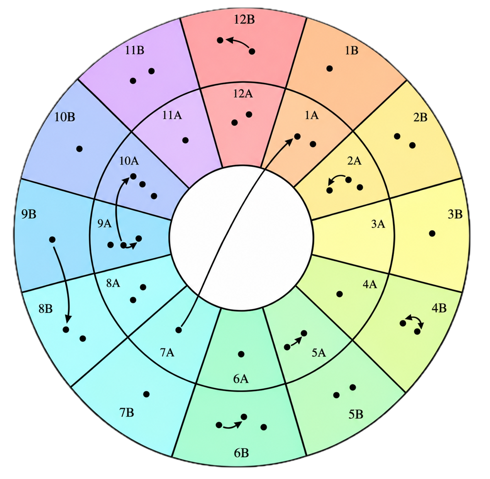

# dj-buddy

<p align="center">
  
</p>

A Haskell tool for planning DJ sets, with a CLI and a basic web app. Browse a music library, suggest next tracks, and generate playlists using harmonic key compatibility and transitions you've tested yourself.

This started with a piece of paper next to the decks. Harmonic compatibility suggested transitions to try, but only some sounded good, so I wrote down the ones that worked. As that list grew, I wanted a way to organise it and use that accumulated knowledge to build better sets.

The core idea is to manually curate a library of transitions you trust. dj-buddy helps you explore and build on those choices. It works entirely with metadata: no audio files, song analysis, or AI. Your ears and taste guide the library.

## Build and run

Requires GHC 9.10–9.14 and Cabal. Run these commands from the project root:

```sh
cabal build
cabal run dj-buddy -- show
cabal run dj-buddy -- show --title "Summer" --key 3D
cabal run dj-buddy -- suggest melody_express -n 3
cabal run dj-buddy -- playlist -s melody_express -n 10
```

Playlists prefer tested transitions, then same-key matches, then compatible keys. Ties are chosen randomly, tracks aren't repeated, and a playlist may end early if no suitable unused track remains. Omit `-s` to start with a random track.

### Web app

Start the Scotty server from the project root:

```sh
cabal run dj-buddy-web
```

Open one of these URLs in your browser. `/show` has a simple HTML page with title and key textboxes and an **Apply filters** button. Leave either textbox empty to omit that filter. Playlist and suggestion pages display numbered track lists with a link back to the library:

| Route | Parameters | Example |
| --- | --- | --- |
| `/show` | Optional `title` and `key` filters | [Show matching tracks](http://localhost:3000/show?title=Summer&key=3D) |
| `/playlist` | Optional `start` track ID; integer `n` defaults to `10` | [Generate a playlist](http://localhost:3000/playlist?start=melody_express&n=10) |
| `/suggest` | Required `track` ID; integer `n` defaults to `3` | [Suggest next tracks](http://localhost:3000/suggest?track=melody_express&n=3) |

Use [http://localhost:3000/show](http://localhost:3000/show) to list all tracks, or [http://localhost:3000/playlist](http://localhost:3000/playlist) to generate a playlist starting with a random track. All three routes accept an optional `lib` parameter, for example `/show?lib=path/to/library.yaml`. Paths are relative to the server's working directory.

Separate query parameters with `&`, omit quotes around values, and URL-encode spaces as `%20`. Invalid keys or non-integer `n` values return HTTP 400. Stop the server with Ctrl+C; restart it after code changes.

## Music library

The default library is [src/library.yaml](src/library.yaml). Use `--lib path/to/library.yaml` with any command to load your own:

```yaml
tracks:
  - id: first_track
    title: First Track
    key: "3D"
  - id: second_track
    title: Second Track
    key: "4D"
transitions:
  - from: first_track
    to: second_track
    notes: "Mix after the breakdown" # optional
```

Keys use numbers `1`–`12` followed by `D` or `M`. Tested transitions are directional; use `transitions: []` if you have none.

## Architecture

The project separates a reusable Haskell library in `src` from the CLI in `app` and the Scotty web app in `web`. `Domain` contains the music library, harmonic compatibility, transition scoring, and playlist logic. `App` exposes application-level operations for browsing tracks, suggesting transitions, and generating playlists; both executables call these operations through `App`.

The web app has a basic library filter form and HTML playlist and suggestion pages; a richer UI can build on the same handlers.

## Future work

- **Library imports:** the YAML file is currently maintained by hand. Importing track metadata from Traktor, rekordbox, and similar tools would make larger libraries easier to manage while keeping transition curation manual.
- **Richer metadata:** the format is deliberately minimal. BPM is omitted because my sets stay around 138–140 BPM, so I already assume the tracks are tempo-compatible. Artist names are also omitted because I know this small collection well. Both would be useful additions as the library grows, but add little to the current proof of concept.
- **Web UI:** expand the basic HTML pages into a richer interface for browsing the library, exploring suggestions, and generating playlists.
- **add some chaos:** the program currently tries to select the "best next transition", looking 1 step ahead. This works, but we could make it smarter, e.g. what if the next immediate transition is fantastic but from then there's nothing interesting we can do from there? And, conversely, what if we pick a next transition which is just ok but then it unlocks an amazing part of the library with a lot of fantastic transitions?
- **clean up the Haskell:** as much as I like learning and playing with Haskell, I'm aware the code isn't probably as clean and idiomatic as it could be.

Licensed under [BSD-3-Clause](LICENSE).
