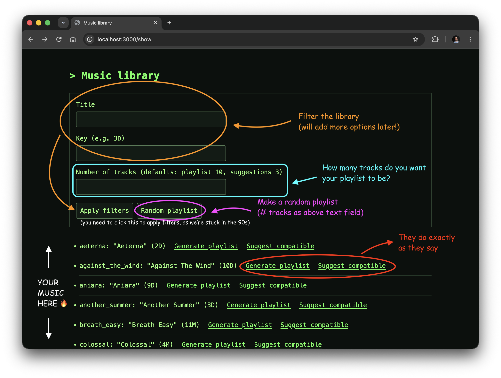

# dj-buddy

<p align="center">
  
</p>

A Haskell utility for planning DJ sets, with a CLI and a (currently rudimentary) web app.

The core idea is to augment the existing harmonic mixing facilities provided by modern DJ software with a curated library of transitions you trust.

dj-buddy helps you explore and build on those data, discovering song suggestions or building entire playlists.

It works entirely with metadata: no audio files, song analysis, or AI. Your ears and taste guide the library.

Detailed explanation is in this [blog post](https://dfilaretti.github.io/dj-buddy/)

## Build and run tests

Install GHC and Cabal with [GHCup](https://www.haskell.org/ghcup/), then build from the project root:

```sh
cabal build

cabal test
```

## Use from the terminal

First, you can get help:

```sh
cabal run dj-buddy -- --help
```

Here are some examples:

```sh
cabal run dj-buddy -- show
cabal run dj-buddy -- show --title "Summer" --key 3D
cabal run dj-buddy -- suggest melody_express -n 3
cabal run dj-buddy -- playlist -s melody_express -n 10
```

## Use from the browser

Start the server from the project root:

```sh
cabal run dj-buddy-web
```

Open [localhost:3000/show](http://localhost:3000/show) and, if you're lucky, you'll see something like this:

<p align="center">
  
</p>


## Music library

The default library is [src/library.yaml](src/library.yaml). Use `--lib path/to/library.yaml` with any command to load your own:

```yaml
tracks:
  - id: first_track
    title: First Track
    key: "3D"
  - id: second_track
    title: Second Track
    key: "4D"
transitions:
  - from: first_track
    to: second_track
    notes: "Mix after the breakdown" # optional
```

(or you can also pass the `lib` option in the URL if using from a browser)

Keys use numbers `1`–`12` followed by `D` or `M`. Tested transitions are directional; use `transitions: []` if you have none.

Licensed under [BSD-3-Clause](LICENSE).
